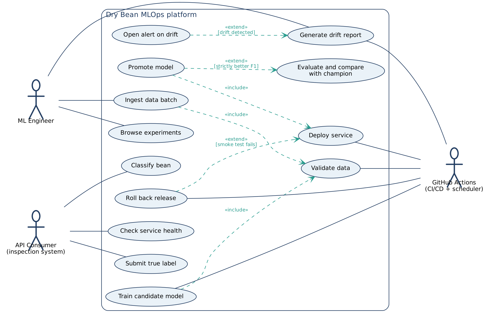
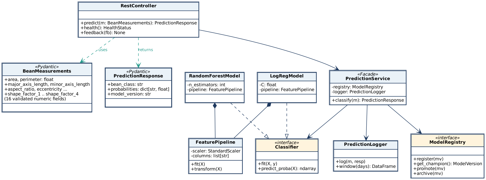
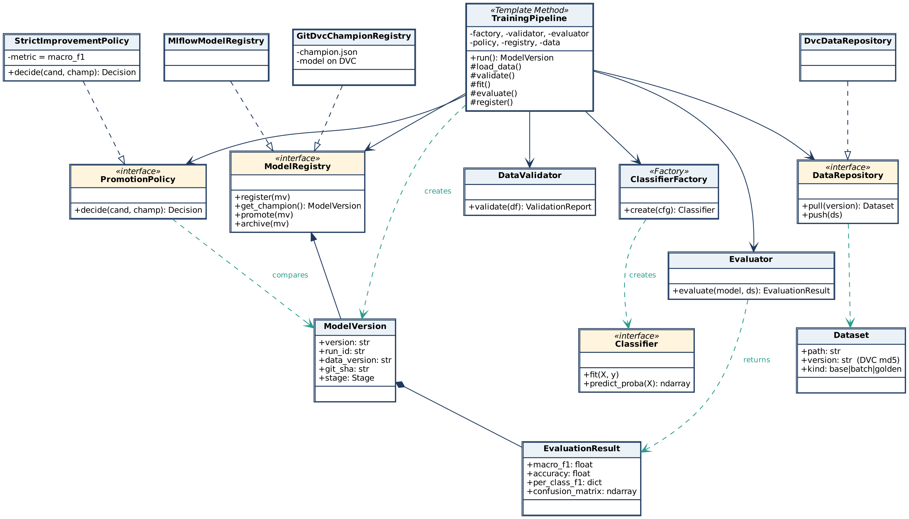
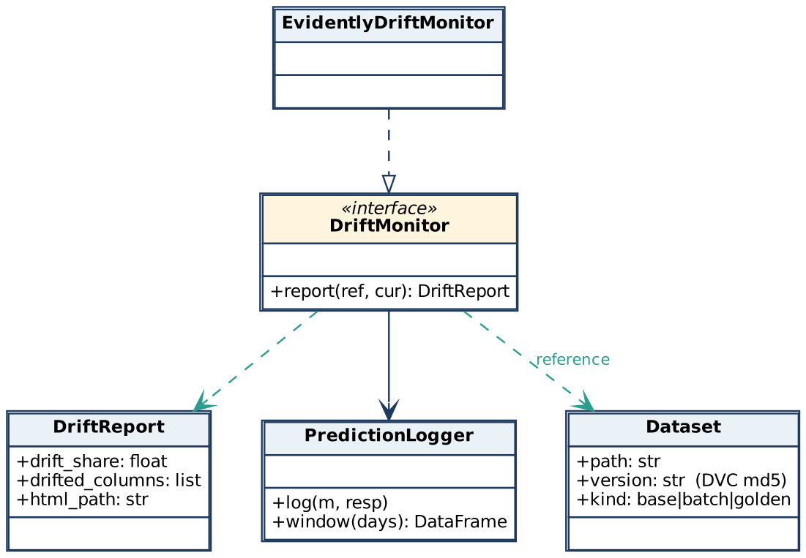
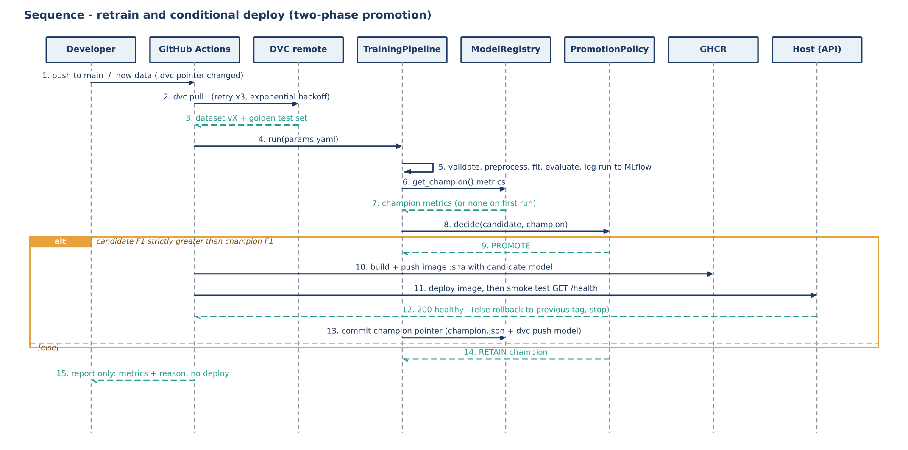
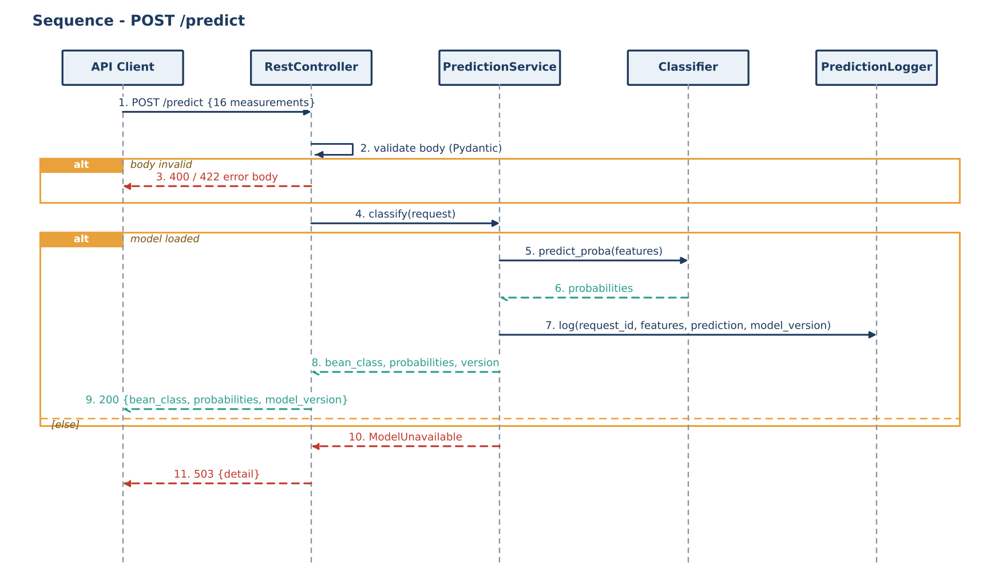
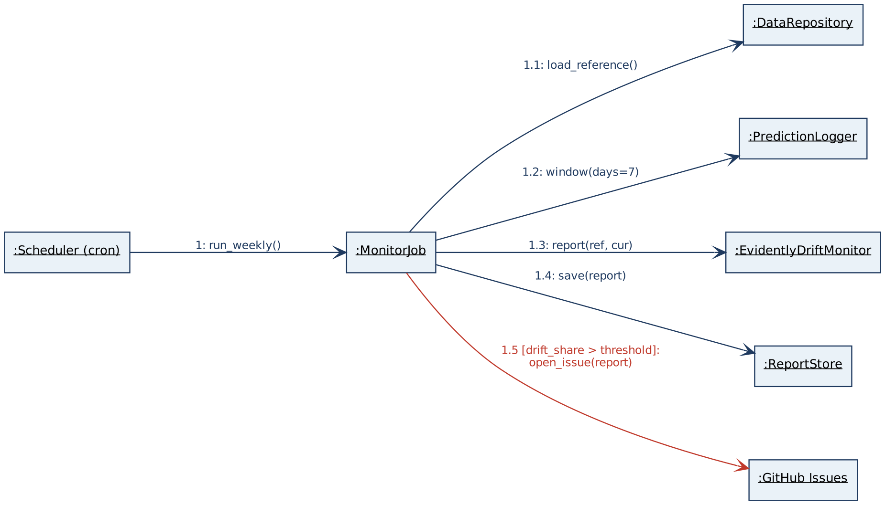
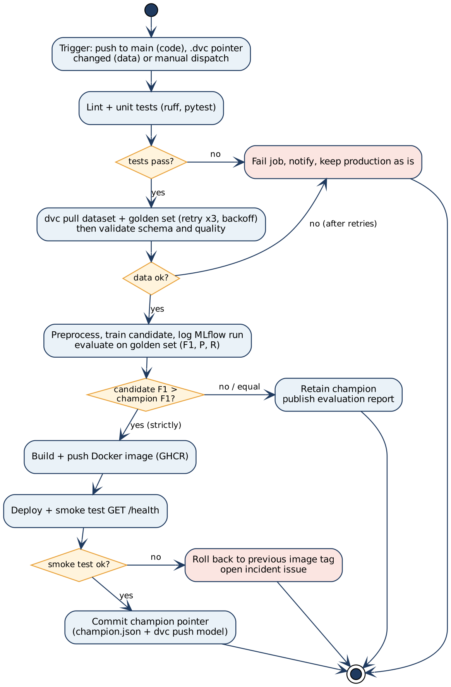
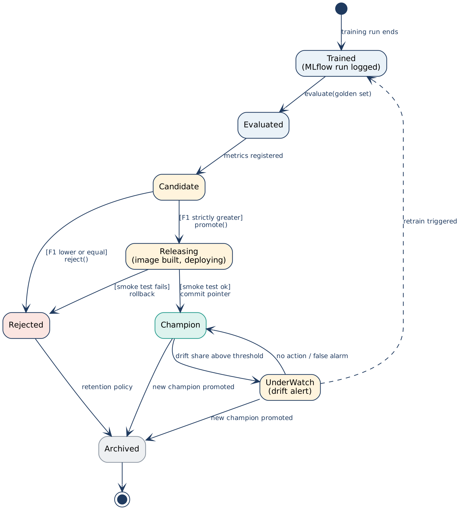
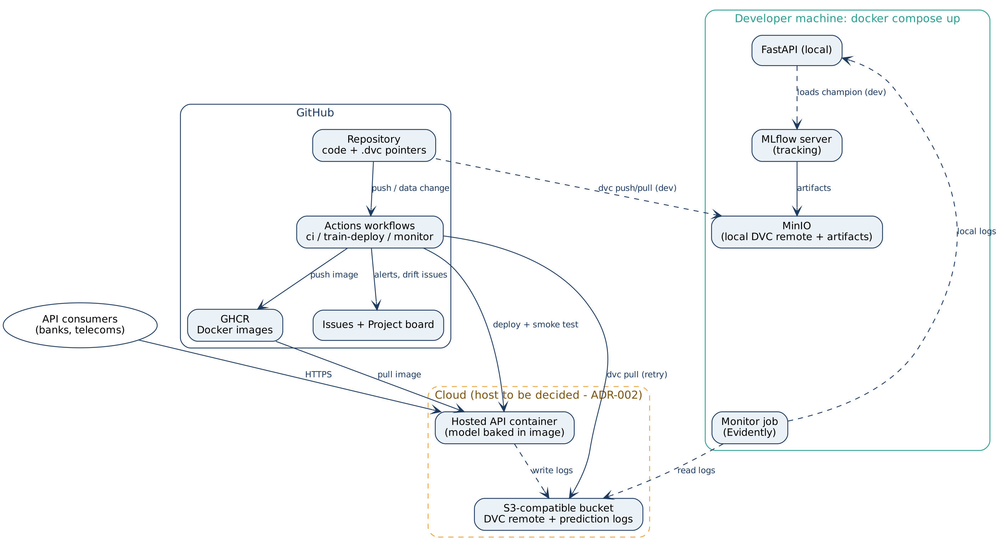

# UML and architecture diagrams

These diagrams accompany the [project plan](../plan/drybean-mlops-project-plan.pdf). The UML views are the original supplied assets; their source files are under [`src/`](src/).

| Diagram | File | UML type | Question it answers | Plan section and phase it drives |
|---|---|---|---|---|
| Use cases | `usecase.png`<br> | Use case | Which actors use the platform, and what are the main workflows and business rules? | §4.1; phase scopes and acceptance criteria across Phases 1–4 |
| Serving classes | `class_serving.png`<br> | Class | How do the API controller, prediction service, classifier, registry, and logger collaborate? | §4.2 (serving side); Phase 1 package seams and Phase 3 API |
| Training classes | `class_training.png`<br> | Class | How are data, validation, training, evaluation, promotion, and model registration separated? | §4.2 (training, evaluation, promotion, registry); Phases 2–3 |
| Monitoring classes | `class_monitoring.png`<br> | Class | How does the drift monitor use reference data and logged predictions to produce a report? | §4.8; Phase 4 monitoring |
| Retrain and promote | `seq_promote.png`<br> | Sequence | In what order does CI retrieve data, train and evaluate a candidate, deploy it, smoke-test it, and update the champion? | §4.3; Phases 2–3 and the safe-deployment flow |
| Predict request | `seq_predict.png`<br> | Sequence | How does `POST /predict` validate a request, return a prediction, and handle unavailable models? | §4.4; Phase 3 API and its error paths |
| Weekly drift monitor | `comm.png`<br> | Communication | Which objects exchange messages during the weekly drift job, and when is an issue opened? | §4.5; Phase 4 monitoring |
| CI/CD workflow | `activity.png`<br> | Activity | Which decisions and failure paths govern training, promotion, deployment, rollback, and retention? | §4.6; Phases 2–3 and failure handling in §9 |
| Model lifecycle | `state.png`<br> | State-transition | Which model states and guarded transitions are allowed from training through promotion, monitoring, rejection, and archival? | §4.7; Phases 2–4 and the model registry |
| System architecture | `arch.png`<br> | Architecture view | How do the developer stack, GitHub workflows, storage, and hosted API fit together? | §5.1; Phases 1–4 |

## Regenerating the diagrams

Prerequisites: Graphviz (`dot`) on `PATH`, Python, and `matplotlib`. Run the supplied generators from `docs/uml/src`. The scripts write their generated images and intermediate `.dot` files into that directory; the actor icons are also read from `img/`.

```bash
cd docs/uml/src
mkdir -p img
python actors.py
python usecase.py
python classdiag.py
python seq.py
python rest.py
for f in img/usecase.png img/class_*.png img/seq_*.png img/comm.png img/activity.png img/state.png img/arch.png; do cp "$f" ..; done
```

The supplied images were not regenerated while adding this index. The regeneration commands have not been run in this environment because Graphviz (`dot`) and Python `matplotlib` are unavailable here. Keep the supplied images as-is; when the prerequisites are available, run the commands in a disposable copy of `src/` to avoid overwriting the provided assets.

When the design changes, update the affected diagram and its source in the same pull request as the code change.
